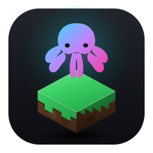

# DevByteLauncher

<div align="center">
  
  <h1>DevByte Launcher</h1>
  <p><strong>Современный высокопроизводительный кроссплатформенный клиент и лаунчер Minecraft Fabric 1.21.1 для DevByte Homelab</strong></p>

  <p>
    <a href="https://github.com/irovbyte/DevByteLauncher/releases/latest"></a>
    <a href="https://dotnet.microsoft.com/"></a>
    <a href="https://avaloniaui.net/"></a>
    <a href="https://fluent2.microsoft.design/"></a>
    <a href="LICENSE"></a>
  </p>
</div>

---

## О проекте

**DevByteLauncher** — специализированный игровой клиент и лаунчер для выделенного игрового сервера **DevByte Homelab** (`mc.obxodka.one`). Построен на базе передового стека технологий **.NET 10** и **Avalonia UI 12.1.4** с полным соблюдением стандартов дизайна **Microsoft Fluent 2 (Windows 11 Dark)**.

Лаунчер обеспечивает бесшовный запуск **Minecraft Fabric 1.21.1**, автоматическую фоновую синхронизацию серверных модификаций, встроенную графическую систему с поддержкой шейдеров (Iris + Sodium), мониторинг статуса хомелаба, официальную авторизацию Microsoft и автоматическое кроссплатформенное обновление приложения через GitHub Releases для Windows и Linux.

---

## Ключевые возможности

### 🎨 Интерфейс Microsoft Fluent 2
- Эстетика Windows 11 Dark с полупрозрачными акриловыми слоями, закруглениями 8px/12px и акцентной подсветкой.
- Плавные кинематические переходы между вкладками (`PageSlide` + `CrossFade`).
- Интерактивные статусные бейджи сервера и пинга в заголовке окна с защитой от наложения на системные кнопки окна.
- Адаптивный скроллинг без визуального шума полос прокрутки.

### ⚡ Производительность и движок запуска
- Сборка на **.NET 10** с компиляцией в единый исполняемый файл (`single-file win-x64` и `linux-x64`).
- Оптимизированные флаги виртуальной машины Java Aikar G1GC (`-XX:+AlwaysPreTouch`, `-XX:+UnlockExperimentalVMOptions`, `-XX:MaxGCPauseMillis=200`).
- Опция автоматического закрытия лаунчера при успешном старте игры для полного освобождения оперативной памяти и ресурсов процессора.
- Возможность выбора диска и директории установки для защиты системного диска `C:` на Windows и поддержка стандарта XDG (`~/.local/share/DevByteMC`) на Linux.

### 🌟 Шейдеры и графика (Iris + Sodium)
- Предустановленные шейдерпаки: **Complementary Reimagined** и **BSL Shaders**.
- Быстрый переключатель шейдеров в лаунчере с двусторонней синхронизацией конфигурации `config/iris.properties` (в игре клавиша `K`).
- Автоматическая валидация и загрузка библиотек графического рендеринга `Iris` и `Sodium` для Fabric 1.21.1.

### 🔄 Автообновление через GitHub Releases
- Фоновая кроссплатформенная проверка свежих релизов через GitHub REST API.
- Атомарная замена исполняемого файла на лету с сохранением POSIX-прав (`chmod +x` на Linux) и автоматической перезагрузкой.
- Автоматическая очистка временных резервных копий предыдущих сборок.

### 🌐 Интеграция с DevByte Homelab
- Прямой пинг сервера `mc.obxodka.one:25565` с отображением онлайна, пинга и списка игроков.
- Фоновый сервис синхронизации модов (`:25566`) с локальным кешированием и сверкой контрольных сумм.
- Поддержка офлайн-аккаунтов и официальной авторизации Microsoft через защищенный Device Code Flow (`https://www.microsoft.com/link`).
- Генерация и рендеринг скинов и аватарок персонажей с использованием SkiaSharp.

---

## Системные требования

| Компонент | Минимальные требования | Рекомендуемые |
|---|---|---|
| **Операционная система** | Windows 10/11 x64, Linux x64 (Ubuntu, Debian, Fedora, Arch, SteamOS) | Windows 11 x64 (23H2+), Ubuntu 24.04 LTS / Arch Linux |
| **Среда выполнения** | Встроена в Single-File Binary | Встроена в Single-File Binary |
| **Java Runtime** | Java 21 LTS x64 (Temurin / Oracle) | Eclipse Temurin JDK 21+ x64 |
| **Оперативная память** | 6 ГБ ОЗУ (выделение лаунчеру от 4 ГБ) | 16 ГБ ОЗУ (выделение лаунчеру 8-10 ГБ) |
| **Видеокарта** | Поддержка OpenGL 4.5 | Дискретный GPU с поддержкой шейдеров Iris |

---

## Быстрый старт

### Windows
1. Перейдите в раздел [Releases](https://github.com/irovbyte/DevByteLauncher/releases/latest).
2. Скачайте файл `DevByteLauncher.exe`.
3. Запустите его, укажите желаемый никнейм (или нажмите кнопку входа Microsoft) и нажмите **Играть**.

### Linux (Установка в одну команду)
Выполните в терминале команду для автоматической установки лаунчера, создания ярлыка в меню приложений и интеграции иконки:

```bash
curl -fsSL https://raw.githubusercontent.com/irovbyte/DevByteLauncher/master/install.sh | bash
```

После завершения скрипта лаунчер доступен в главном меню приложений вашей системы или по команде `devbyte-launcher`.

Для ручной установки скачайте `DevByteLauncher-linux-x64` из [Releases](https://github.com/irovbyte/DevByteLauncher/releases/latest) и сделайте его исполняемым:
```bash
chmod +x DevByteLauncher-linux-x64
./DevByteLauncher-linux-x64
```

---

## Сборка из исходного кода

### Необходимые инструменты
- [.NET 10.0 SDK](https://dotnet.microsoft.com/download/dotnet/10.0)
- Git CLI

### Клонирование и сборка
```bash
git clone https://github.com/irovbyte/DevByteLauncher.git
cd DevByteLauncher
dotnet build -c Release
```

### Публикация для Windows
```powershell
dotnet publish DevByteLauncher.csproj -c Release -r win-x64 --self-contained -p:PublishSingleFile=true -o ./publish-win
```

### Публикация для Linux
```bash
dotnet publish DevByteLauncher.csproj -c Release -r linux-x64 --self-contained -p:PublishSingleFile=true -o ./publish-linux
```

---

## Структура репозитория

```
DevByteLauncher/
├── Assets/                # Иконки приложения, векторные SVG и маскот
├── Models/                # Модели данных настроек, модов, накопителей и обновлений
├── Services/              # Сервисы пинга, шейдеров, синхронизации, скинов и запуска
├── ViewModels/            # Реактивные ViewModel (CommunityToolkit.Mvvm)
├── Views/                 # Окна и XAML разметка (Fluent 2 Dark)
├── .github/workflows/     # CI/CD пайплайны GitHub Actions
├── App.axaml              # Стили и темы Avalonia
├── install.sh             # Скрипт автоматической установки для Linux
├── LICENSE                # Лицензия MIT
└── README.md              # Документация проекта
```

---

## Лицензия

Проект распространяется под открытой лицензией [MIT](LICENSE).

Автор: **Роман Зопиров ([irovbyte](https://github.com/irovbyte))**
